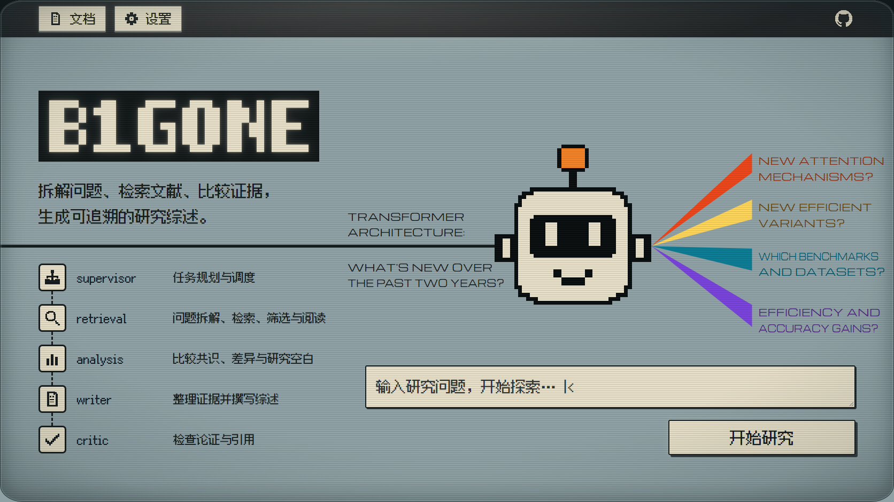
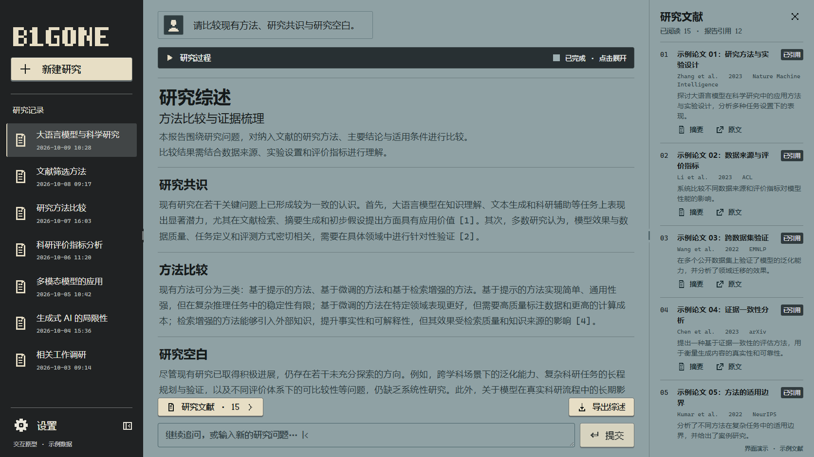
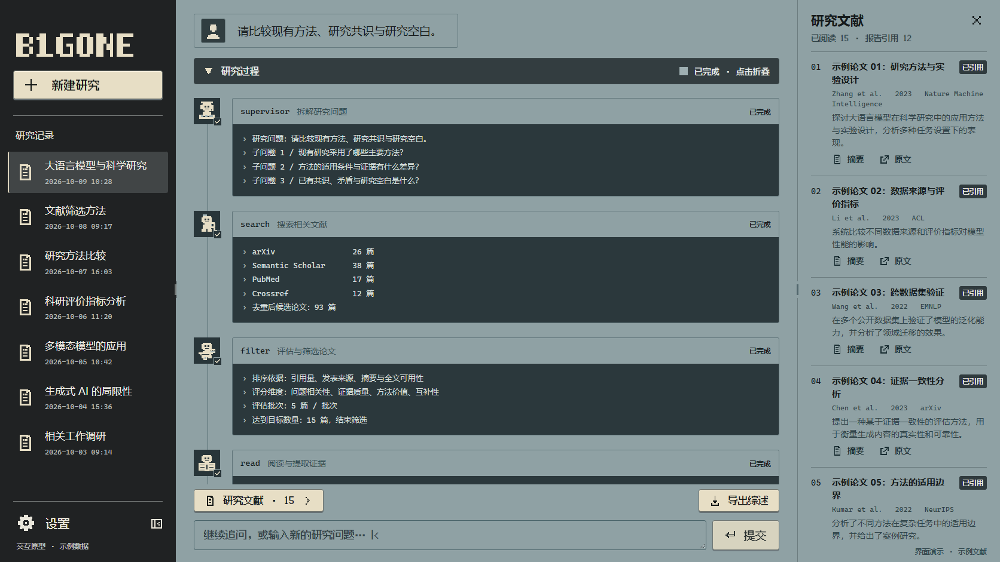

# B1GONE

一个多 Agent 学术研究助手：从研究问题出发，拆解检索方向、筛选论文、提取证据，比较研究共识、差异与空白，并生成带有引用的研究综述。

当前前端使用 React + TypeScript + Vite + Tailwind CSS，后端使用 FastAPI + LangGraph。界面采用灰蓝画布、黑色终端面板和奶白按键；首页保留 CRT 扫描线、余晖与像素机器人，会话页使用适合阅读的正文排版。

## 界面预览

以下为当前页面截图。会话中的综述、论文和研究记录使用演示数据，仅展示界面与交互形式。

### 首页

输入研究问题后进入研究工作台；输入为空时点击“开始研究”，直接进入空的会话页面。



### 会话页面

左侧保存研究历史，中间展示研究过程和综述，右侧查看实际阅读文献。两侧栏均支持拖动调宽，左侧栏可以收起。



<details>
<summary>查看展开的研究过程</summary>

各阶段展示返回的拆解问题、检索数量、筛选信息和阅读结果，完成后可以折叠保留。



</details>

## 主要功能

| 功能 | 当前实现 |
| --- | --- |
| 多源检索 | 从 arXiv、Semantic Scholar、PubMed、Crossref 搜索并去重，目标为 80–100 篇候选论文 |
| 论文筛选 | 先按相关性与元数据粗排，再由模型多维评分；默认每批 5 篇，单次筛选输出预算 6,000 token，满足目标数量后提前停止 |
| RAG 阅读 | 将可用论文内容分块入库，检索相关片段并生成阅读记录 |
| 跨论文分析 | 汇总研究共识、差异、矛盾与研究空白，供综述写作使用 |
| 综述与追问 | 显示 Markdown 报告、关联引用、查看论文摘要和原文、导出综述，并围绕当前研究继续提问 |
| 过程与历史 | SSE 返回调度和阶段结果，SQLite 保存已完成研究与会话消息 |
| 本机设置 | 首页和会话页共用设置弹窗，可保存白名单模型配置；重启后端后生效 |
| 错误追踪 | 结构化日志、请求编号和错误编号，便于定位异常 |
| 运行指标 | 首页下滑查看耗时、token、完成率、检索与证据指标；由本机真实记录计算 |

筛选目标、成功阅读数量和正文引用数量是不同计数，实际结果以返回的有效证据为准。检索不足或内容不可用时，会报告对应错误或提示。详细规则见 [论文检索与筛选说明](backend/SEARCH_AND_SCREENING.md)。

## 首次安装

以下命令以 Windows PowerShell、项目目录 `D:\BIGONE` 为例；项目放在其他目录时替换相应路径。

### 环境要求

- Conda 和名为 `BIGONE` 的 Python 环境；当前本机已验证 Python 3.13。
- Node.js 22.12 或更新版本；也支持 20.x 中的 20.19 及更新版本，符合当前 Vite 的要求。
- Windows PowerShell 5.1 或兼容环境，用于双击启动脚本。
- 用于研究模型与 embedding 的 API 凭证，以及可访问模型服务和文献源的网络。

### 安装后端依赖

如果已经有 `BIGONE` 环境，从 `conda activate BIGONE` 开始即可。

```powershell
cd D:\BIGONE
conda create -n BIGONE python=3.13 -y
conda activate BIGONE
python -m pip install -r requirements.txt
```

### 准备配置

从项目根目录创建 `.env`。下面的命令只在文件不存在时复制模板，保留已有配置：

```powershell
if (-not (Test-Path -LiteralPath .env)) {
    Copy-Item -LiteralPath .env.example -Destination .env
}
```

按 [.env.example](.env.example) 填写配置，也可以在后端启动后通过页面“设置”保存支持的字段。

| 配置项 | 用途 |
| --- | --- |
| `OPENAI_API_KEY` / `ANTHROPIC_API_KEY` | 研究模型密钥，配置一个即可；同时配置时优先使用 `OPENAI_API_KEY` |
| `BASE_URL` | 当前研究模型的 OpenAI 兼容接口地址，必须与密钥和模型名称匹配 |
| `DEFAULT_MODEL` / `LIGHT_MODEL` | 主要模型和轻量模型名称 |
| `DASHSCOPE_API_KEY` | 独立的 embedding 服务密钥 |
| `DASHSCOPE_BASE_URL` / `EMBEDDING_MODEL` | embedding 服务地址与模型名称 |
| 文献源 API key / 联系邮箱 | 按模板设置检索源的可选凭证和联系方式 |

`ANTHROPIC_API_KEY` 在当前实现中作为备用密钥变量，仍用于 `BASE_URL` 对应的 OpenAI 兼容请求；变量名称不会自动切换模型服务。设置页不会回显密钥明文，保存配置后需要重启后端。请从项目根目录启动后端，使 `.env` 的加载位置正确。

### 安装前端依赖

```powershell
cd D:\BIGONE\web
npm ci
```

## 启动项目

### Windows 双击启动

完成首次安装后，在项目根目录双击 [启动B1GONE.bat](启动B1GONE.bat)。它会启动后端 `3000` 和前端 `5173`，等待服务就绪，再打开 [http://127.0.0.1:5173/](http://127.0.0.1:5173/)。

保留启动窗口，按 **Enter / Q** 或 **Ctrl+C** 停止启动器管理的服务。输出写入 `logs/launcher-*.log`。已有手动服务占用端口时，先在原终端按 Ctrl+C 关闭，再使用 BAT。

也可以从项目根目录传入参数：

```powershell
.\启动B1GONE.bat             # 普通启动
.\启动B1GONE.bat -Observe    # 启动并记录完整 token 与检索信息
.\启动B1GONE.bat -Stop       # 关闭启动器管理的服务
.\启动B1GONE.bat -CheckOnly  # 只检查依赖，不启动服务
```

双击时找不到 Conda/npm，可指定本机安装路径：

```powershell
.\启动B1GONE.bat -CondaPath "D:\anaconda\condabin\conda.bat" -NpmPath "D:\nodejs\npm.cmd"
```

BAT 不会自动安装依赖，普通模式使用 `backend.main:app`，观测模式使用 `evaluation.observed_app:app`；日常启动默认不启用后端自动重载。

### 手动启动

打开两个终端，分别运行后端和前端，并保持它们开启。

**终端一：后端**

```powershell
cd D:\BIGONE
conda activate BIGONE
python -m uvicorn backend.main:app --host 127.0.0.1 --port 3000
```

看到 `Application startup complete` 表示后端启动成功。开发时可以追加 `--reload --reload-dir backend`，或使用已有的 `scripts/start_backend.ps1`。

**终端二：前端**

```powershell
cd D:\BIGONE\web
npm run dev
```

浏览器打开 [http://127.0.0.1:5173/](http://127.0.0.1:5173/)。当前 Vite 开发服务将 `/api` 和 `/health` 代理到 `http://127.0.0.1:3000`；如修改后端端口，需要同步修改 [web/vite.config.ts](web/vite.config.ts) 的代理地址。生产部署需另行配置 API 反向代理。

### 演示模式

访问 [首页演示](http://127.0.0.1:5173/?demo=1) 或 [会话页演示](http://127.0.0.1:5173/research?demo=1)，可以查看界面和模拟研究过程，演示研究不调用模型。演示模式中的“设置”仍访问真实的本机配置接口。

运行真实任务时使用不带 `?demo=1` 的地址。研究过程显示“已完成”、出现综述及导出按钮后，可以继续追问；刷新后从历史记录重新打开，可以确认结果已保存。

旧版 Streamlit 入口仍保留在 [frontend/streamlit_app.py](frontend/streamlit_app.py)，当前默认使用上面的 React 工作台。

<details>
<summary>旧版 Streamlit 启动方式</summary>

```powershell
cd D:\BIGONE
conda activate BIGONE
python -m streamlit run frontend/streamlit_app.py
```

旧前端默认连接 `http://127.0.0.1:3000`；若修改后端端口，在启动 Streamlit 的终端设置 `BACKEND_URL` 为实际地址，再重新启动。

</details>

## 首页指标与评估

首页“运行与评测”读取本机生成的 `web/public/metrics/summary.json`。它不会在点击“刷新读数”时自动运行采集脚本，也不会把演示研究计入真实指标。

为新任务记录完整 usage 和检索 ID，使用 `启动B1GONE.bat -Observe`；手动启动对应命令为：

```powershell
cd D:\BIGONE
conda activate BIGONE
python -m uvicorn evaluation.observed_app:app --host 127.0.0.1 --port 3000
```

任务结束后，在 BIGONE 环境、项目根目录更新快照，再点击首页“刷新读数”：

```powershell
python -m evaluation.update_metrics
```

如已有真实质量标注，显式传入标注文件：

```powershell
python -m evaluation.update_metrics --labels evaluation/labels.jsonl
```

| 指标 | 数据来源 |
| --- | --- |
| P50 / P95 / P99、平均完成耗时 | 有有效计时记录的成功任务 |
| 平均 LLM / embedding token | 模型接口返回的完整 usage；历史部分记录单独列出 |
| 完成率、失败率、重试、阅读结果率 | 日志、明确任务终态和保存的研究结果 |
| 检索非空返回率 | 实际检索记录，表示是否取得上下文 |
| RAG Hit@K / Recall / MRR | 实际检索排名与独立标注的相关切片 |
| 论文 Precision / Recall | 筛选列表、论文相关性判定和参考论文集合 |
| 事实支持率、引用覆盖率 | 对报告事实、证据支持与正文引用归属的标注 |

`N/A` 表示缺少有效记录或标注。增加研究任务可以积累运行统计；质量指标还需要独立评估数据，示例标注文件不能直接当作真实结果。具体口径和标注格式见 [评估说明](evaluation/README.md)。

**统计属于当前本机项目。**数据库、日志、观测记录、实际标注和生成的快照均被 Git 忽略。从 GitHub 下载源码不会带走开发者的实测值；新用户首次没有快照时显示暂无统计，运行并更新后看到自己的数据。

构建前存在的 public 快照会被 Vite 复制到 `web/dist`。如果分发构建目录或部署静态网站，访问者会看到包内的构建时快照；更新 public 后需要重新构建才会改变该静态包。当前没有单独发布官方基准数据。

## 项目结构

```text
B1GONE/
├─ backend/             FastAPI、Agent 工作流、文献工具与 RAG
├─ web/                 当前 React 前端
├─ evaluation/          独立观测、指标计算与质量标注格式
├─ scripts/             启动脚本与诊断工具
├─ docs/                实现说明、设计资料与页面截图
├─ frontend/            旧版 Streamlit 前端
├─ data/                本机数据库、论文与向量缓存（Git 忽略）
├─ logs/                后端和启动器日志（Git 忽略）
└─ 启动B1GONE.bat        Windows 双击入口
```

## 日志与检查

后端结构化日志位于 `logs/backend.log`，自动轮转。HTTP 响应包含 `X-Request-ID`，HTTP/SSE 错误提供 `error_id`，可用编号关联请求与异常。排查方法见 [后端错误追踪说明](backend/ERROR_HANDLING.md)。

后端和评估检查，在 BIGONE 环境、项目根目录运行：

```powershell
python -m pytest backend/tests -q
python -m unittest discover -s evaluation/tests -v
```

前端检查，在 `web` 目录运行：

```powershell
npm run build
npm run test:e2e
```

启动器隔离检查，在项目根目录运行：

```powershell
powershell -NoProfile -ExecutionPolicy Bypass -File scripts/tests/test_project_launcher.ps1
```

浏览器测试默认使用本机 Edge；联调测试拦截研究请求，不调用真实研究模型。测试截图及临时结果位于 Git 忽略的 `tmp`，本 README 的展示图片单独保存在 `docs/images`。

更多界面交互与字体说明见 [前端说明](web/README.md)。项目许可证见 [LICENSE](LICENSE)，字体授权文件位于 [web/public/fonts](web/public/fonts)。
